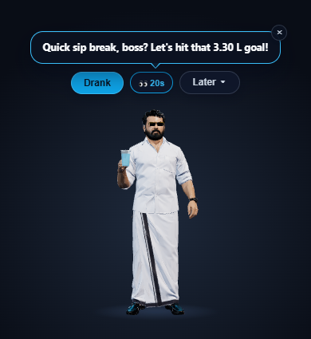
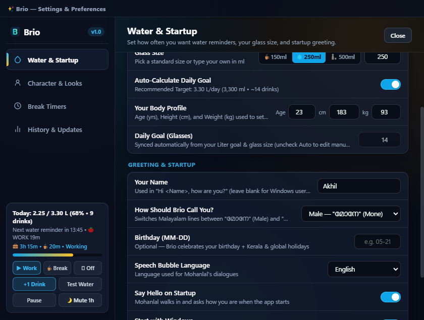
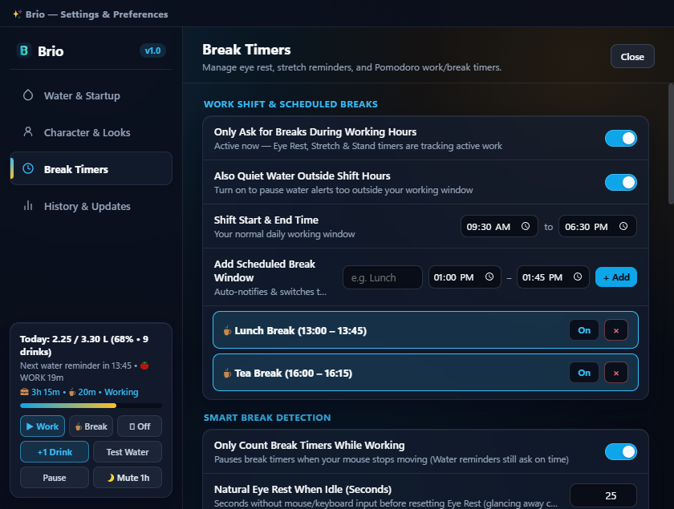
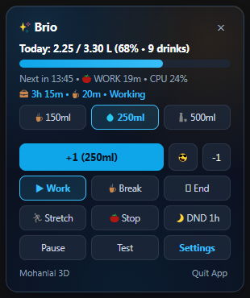
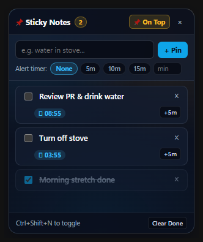
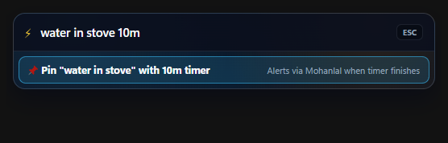

# ✨ Brio — Your 3D Desktop Companion

> A lively Windows 3D desktop companion built with Electron & Three.js featuring **Mohanlal 3D** (plus custom `.glb` characters) for hydration tracking, smart break timers, quick command notes, and calm focus rituals.

[-0ea5e9?style=for-the-badge)](https://github.com/AKHXI1/Brio-your-pc-companion/releases/tag/v1.0.0)
[](#running--building)

<p align="center">
  
</p>

## 📸 Screenshots

<table>
  <tr>
    <td align="center" width="50%">
      
      <br />
      <sub><b>Water &amp; Startup</b> — Auto-calculated daily goal from age, height &amp; weight</sub>
    </td>
    <td align="center" width="50%">
      
      <br />
      <sub><b>Break Timers</b> — Work shift schedule, Lunch/Tea breaks &amp; smart break detection</sub>
    </td>
  </tr>
  <tr>
    <td align="center" width="50%">
      
      <br />
      <sub><b>Tray Quick Dashboard</b> — Fast drink logging, glass sizes &amp; shift status</sub>
    </td>
    <td align="center" width="50%">
      
      <br />
      <sub><b>Sticky Notes &amp; Timers</b> — Pin quick reminders with live countdown alerts</sub>
    </td>
  </tr>
</table>

<p align="center">
  
  <br />
  <sub><b>Quick Command Palette</b> — Instant natural-language sticky timers, drink logging &amp; break controls</sub>
</p>

## ✨ Highlights

- **Interactive 3D Companion**: Single-click for signature *Meesha Pirikkal* reactions, double-click to log a drink, drag horizontally along the taskbar/screen, or hover for subtle head & eye cursor tracking.
- **Superstar Mode & 3D Props**: Unlock 3D sunglasses when hitting your daily hydration goal, enjoy a steaming evening *Chaya* cup, and adapt with dynamic day/evening/night lighting.
- **Profile-Aware Hydration & Smart Context**: Automatically calculates your daily water goal from your age, height, weight, and local weather (`>=31°C`), avoids interrupting live Zoom/Teams/Meet calls, and persists user data safely across reinstalls.
- **Wellness & Break Suite**: Tracks work shifts and scheduled Lunch/Tea breaks alongside `20-20-20` Eye Rest, Desk Stretch, Stand Breaks, Pomodoro, and 1-Minute Box Breathing.
- **Quick Dashboard, Sticky Notes & Command Palette**: Log sips fast, pin timed sticky notes (e.g., `water in stove 10m`), or use global shortcuts (`Ctrl+Shift+D` to log a drink, `Ctrl+Shift+M` to summon Brio).

## ⬇️ Download & Install

Grab the latest Windows installer (`Brio-Setup-1.0.0.exe`) directly from **[GitHub Releases](https://github.com/AKHXI1/Brio-your-pc-companion/releases/tag/v1.0.0)**.

## 🛠️ Running & Building

```bash
npm install
npm start            # Launch Brio desktop companion
npm run settings     # Open Settings window directly
npm test             # Run Electron helper unit tests
npm run build:win    # Build Windows NSIS installer into dist/
```

Or on Windows, double-click **`Start Brio.bat`** or **`Open Settings.bat`**.
